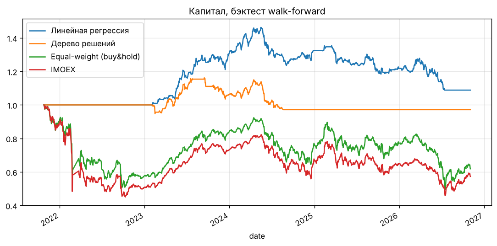

# Отчёт

Тикеры: SBER, GAZP, LKOH, GMKN, NVTK, ROSN, PLZL, TATN, MTSS, MGNT
Период: 2021-10-25 — 2026-11-03

## Метрики (ml_* — качество прогноза out-of-sample; остальное — бэктест)

|                         |   Линейная регрессия |   Дерево решений |
|:------------------------|---------------------:|-----------------:|
| ml_n                    |           10830      |       10830      |
| ml_MAE                  |               0.0324 |           0.0338 |
| ml_RMSE                 |               0.0446 |           0.0463 |
| ml_R2                   |              -0.0928 |          -0.1774 |
| ml_directional_accuracy |               0.496  |           0.4584 |
| ml_IC                   |               0.0835 |           0.0137 |
| CAGR                    |               0.0155 |          -0.0052 |
| vol                     |               0.0844 |           0.058  |
| Sharpe                  |               0.2239 |          -0.0609 |
| Sortino                 |               0.3114 |          -0.0801 |
| MaxDD                   |              -0.2559 |          -0.1637 |
| Calmar                  |               0.0604 |          -0.0318 |
| turnover                |               0.0718 |           0.0131 |

## Признаки

### Линейная регрессия
Топ-признаки:

sma_ratio_20     0.024882
macd_hist       -0.019420
macd            -0.014697
sma_ratio_50    -0.008787
rsi_14           0.008326
rel_imoex_20d    0.005693
vol_20d         -0.005506
ret_1d          -0.004590

### Дерево решений
Топ-признаки:

imoex_ret_5d     0.573221
imoex_ret_1d     0.234108
usdrub_ret_5d    0.192671
ret_5d           0.000000
ret_1d           0.000000
vol_10d          0.000000
ret_20d          0.000000
ret_10d          0.000000

